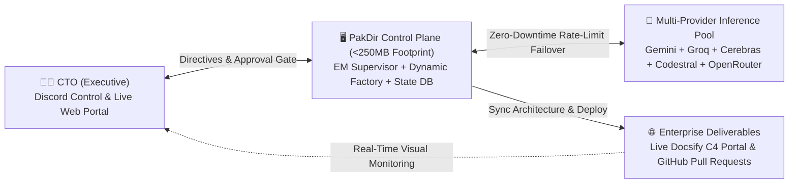

<p align="center">
  <h1 align="center">🏢 PakDir</h1>
  <p align="center">
    <strong>The Autonomous AI Engineering Organization & CTO Control Plane</strong><br>
    <em>Govern a self-evolving, multi-agent engineering department with strict human-in-the-loop oversight.</em>
  </p>
</p>

<p align="center">
  <a href="LICENSE"></a>
  <a href="https://www.python.org/downloads/"></a>
  <a href="https://opencode.ai"></a>
  <a href="#resource-aware-architecture"></a>
  <a href="#llm-router"></a>
</p>

---

## Overview

**PakDir** is an open-source control plane and multi-agent orchestration framework designed for solo founders, technical entrepreneurs, and engineering leaders. It empowers a single person to act as an executive **Chief Technology Officer (CTO)** governing an autonomous software engineering organization powered by AI agents.

Unlike traditional multi-agent systems that demand heavy GPU infrastructure or consume gigabytes of idle resident memory, PakDir is engineered with **Resource-Aware Architecture**:
- **Minimal Control Plane Footprint:** The entire management layer operates under **250MB resident memory**, leaving the vast majority of host resources for your actual application workloads.
- **Environment Agnostic:** Runs identically across local developer environments (macOS, Linux, Windows), entry-level cloud VPS instances, dedicated bare-metal, and containerized clusters.
- **Zero-Downtime Multi-Provider LLM Routing:** Built-in automatic failover across free and open-weight model endpoints prevents workflow interruption during rate limits.
- **Strict Human-in-the-Loop Governance:** AI agents operate on isolated feature branches and cannot deploy to production without explicit CTO authorization.



---

## Core Capabilities

### 1. 👔 Hierarchical Supervision & Dynamic Agent Factory
Interact with a single, accountable executive interface: the **Engineering Manager (`@em`)**.
- **Dynamic Subagent Provisioning (`hire_agent`):** When complex projects require niche competencies (e.g., application security audits, query performance tuning, specialized frontend frameworks), `@em` autonomously generates declarative agent definitions, configures sandbox boundaries, and updates the corporate hierarchy.
- **Prompt Specialization (`specialize_agent`):** Continuously sharpens individual subagent SOPs as project conventions evolve.
- **Autonomous Self-Healing Loop:** When unit tests or linters fail, `@em` automatically loops with `@dev` to remediate errors up to 3 times before requesting executive intervention.

### 2. 🧠 Multi-Provider Free Inference Router
PakDir eliminates provider lock-in and eliminates quota downtime through intelligent, priority-weighted failover:
- **Reasoning Tier (`@em`, `@architect`, `@pm`):** Google Gemini 2.5 Pro $\rightarrow$ OpenRouter DeepSeek R1 (`:free`) $\rightarrow$ Groq Llama 3.3 70B $\rightarrow$ Cerebras Llama 3.3 70B.
- **Coding Tier (`@dev`, `@ops`):** Mistral Codestral $\rightarrow$ OpenRouter Qwen 2.5 Coder (`:free`) $\rightarrow$ Gemini 2.5 Flash $\rightarrow$ Groq Llama 3.3 70B.
- Automatically handles HTTP `429 Too Many Requests` by rotating to adjacent endpoints within milliseconds.

### 3. 🛡️ Executive Approval Gate (Human-in-the-Loop)
Agents are strictly sandboxed to feature branches (`feat/*`). Pull Requests enter a persistent `WAITING_CTO_APPROVAL` queue in the SQLite state store. Only after the CTO issues `!approve <task_id>` will `@ops` merge to `main` and execute release deployment.

### 4. 📊 Real-Time Architecture & Live Org-Chart Portal
PakDir features a zero-compilation documentation engine powered by **Docsify + Mermaid.js v11**:
- **Dynamic Organizational Hierarchy:** Automatically synchronizes as specialized subagents are hired or retired.
- **C4 System Context & Container Models:** Visual diagrams maintained continuously by `@architect`.
- **Database ERD & Architecture Decision Records (ADR):** Traceable historical log of technical decisions.

---

## Resource-Aware Architecture

PakDir decouples the orchestration control plane from the host capacity:

| Layer | Component | Memory Overhead | Description |
| :--- | :--- | :--- | :--- |
| **Control Plane** | Python Daemon (`asyncio`) | ~60 MB | Discord event bridge & supervisory state engine |
| **Agent Runtime** | OpenCode Engine | ~120 MB | Headless task execution (`lsp: false` on-demand) |
| **State Storage** | SQLite3 (`WAL Mode`) | ~15 MB | Task tracking, audit trail, approval queue |
| **Architecture Portal** | Caddy v2 + Docsify | ~15 MB | Reverse proxy & static visual documentation |
| **Host Workload** | **User Applications** | **Remaining Host RAM** | **Full allocation for runtimes, databases & tests** |

> 💡 **Deploying on Constrained Hardware?**  
> Check our reference guide: [Self-Hosting & Node Deployment Guide](docs/deployment/self-hosting.md).

---

## Quickstart Guide

### 1. Installation

```bash
git clone https://github.com/your-username/pak-dir.git
cd pak-dir
pip install -e .
```

### 2. Verify System & Run Test Suite

```bash
python -m unittest discover -s tests -p "test_*.py" -v
```

### 3. Launch the Architecture & Org Portal Locally

```bash
python -m http.server 8090 --directory docs
```
Open `http://localhost:8090` in your web browser.

### 4. CLI Dynamic Agent Management

```bash
# View active AI engineering roster
python -m orchestrator.agent_factory list

# Dynamically recruit a specialized subagent
python -m orchestrator.agent_factory hire \
  --name "security-auditor" \
  --title "Application Security Auditor" \
  --description "Audits OWASP Top 10 vulnerabilities" \
  --sop "1. Inspect all API endpoints. 2. Verify input validation. 3. Ensure zero hardcoded credentials." \
  --tools "bash"
```

---

## Production Deployment Profiles

PakDir includes production-ready deployment assets in `deploy/`:
- **[Budget Cloud VPS Profile (Ubuntu Minimal)](docs/deployment/vps-guide.md):** Complete guide for running on $4–$6/mo budget VPS nodes with automated Swap and ZRAM provisioning.
- **Systemd Service:** `deploy/systemd/pakdir-orchestrator.service` with configurable resident memory safeguards (`MemoryMax`).
- **Web Reverse Proxy:** `deploy/Caddyfile` for automatic HTTPS and documentation serving.

---

## Discord Command Reference

Connect your private Discord workspace to govern your AI engineering team:

| Command | Description |
| :--- | :--- |
| `!task <directive>` | Assign an initiative to `@em` (orchestrates PRD $\rightarrow$ Architecture $\rightarrow$ Dev $\rightarrow$ QA). |
| `!ask <agent> <query>` | Query any agent directly (e.g., `!ask architect explain the database indexing strategy`). |
| `!agents` | Display the active roster of AI personnel and their tool permissions. |
| `!hire <name> <spec>` | Dynamically recruit and provision a new specialist subagent. |
| `!specialize <name> <focus>` | Refine or specialize the operational SOP of an existing agent. |
| `!pending` | View deliverables and Pull Requests awaiting executive approval. |
| `!approve <task_id>` | Grant executive authorization to merge to `main` and deploy. |
| `!reject <task_id> <notes>` | Reject task and request revisions from the engineering team. |
| `!health` | Inspect real-time server telemetry (RAM, Swap, CPU, Disk, and LLM pools). |

---

## Project Structure

```text
pak-dir/
├── .opencode/
│   └── agent/                     # Declarative subagent prompts & SOPs
│       ├── em.md                  # Engineering Manager & Dynamic Org Builder
│       ├── pm.md                  # Product Manager (PRD & Acceptance Criteria)
│       ├── architect.md           # System Architect (C4 Diagrams, ERD, ADR)
│       ├── dev.md                 # Fullstack Engineer (Feature branches & tests)
│       ├── ops.md                 # QA & DevOps (Test validation & node telemetry)
│       └── archive/               # Archived specialist prompts
├── data/                          # Persistent SQLite WAL state database
├── deploy/                        # Infrastructure deployment profiles & automation
│   ├── setup-host.sh              # General host setup script
│   ├── Caddyfile                  # Lightweight web server configuration
│   └── systemd/                   # Memory-capped systemd service definitions
├── docs/                          # Live Docsify & Mermaid Architecture Portal
│   ├── index.html                 # Docsify SPA entry point
│   ├── _sidebar.md                # Navigation sidebar
│   ├── README.md                  # Executive dashboard overview
│   ├── architecture/              # C4 models, sequences, ERD, ADR, and live org chart
│   ├── deployment/                # Hardware-specific deployment guides
│   └── prd/                       # Product backlog and specifications
├── orchestrator/                  # Python control plane package
│   ├── __init__.py                # Package metadata
│   ├── agent_factory.py           # Dynamic subagent provisioning & org-chart sync
│   ├── discord_bot.py             # Discord executive control interface
│   ├── llm_router.py              # Zero-cost multi-provider LLM fallback router
│   ├── state_db.py                # SQLite WAL state store
│   └── supervisor.py              # EM supervisory state machine & self-healing loop
├── tests/                         # End-to-end integration & unit test suite
├── .env.example                   # Environment credential template
├── opencode.json                  # OpenCode runtime configuration (LSP disabled)
├── pyproject.toml                 # Standard packaging specification
└── README.md                      # Primary project documentation
```

---

## License

This project is licensed under the [MIT License](LICENSE).
