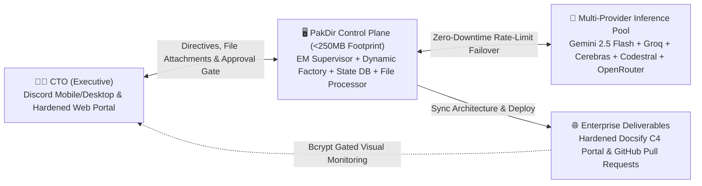

<p align="center">
  <h1 align="center">🏢 PakDir</h1>
  <p align="center">
    <strong>The Autonomous AI Engineering Organization & CTO Control Plane</strong><br>
    <em>Govern a self-evolving, multi-agent engineering department with strict human-in-the-loop oversight.</em>
  </p>
</p>

<p align="center">
  <a href="LICENSE"></a>
  <a href="https://www.python.org/downloads/"></a>
  <a href="https://opencode.ai"></a>
  <a href="#resource-aware-architecture"></a>
  <a href="#llm-router"></a>
</p>

---

## Overview

**PakDir** is an open-source control plane and multi-agent orchestration framework designed for solo founders, technical entrepreneurs, and engineering leaders. It empowers a single person to act as an executive **Chief Technology Officer (CTO)** governing an autonomous software engineering organization powered by AI agents.

Unlike traditional multi-agent systems that demand heavy GPU infrastructure or consume gigabytes of idle resident memory, PakDir is engineered with **Resource-Aware Architecture**:
- **Minimal Control Plane Footprint:** The entire management layer operates under **250MB resident memory**, leaving the vast majority of host resources for your actual application workloads.
- **Environment Agnostic:** Runs identically across local developer environments (macOS, Linux, Windows), entry-level cloud VPS instances (tested on 2GB RAM + 4GB Swap), dedicated bare-metal, and containerized clusters.
- **Zero-Downtime Multi-Provider LLM Routing:** Prioritized by default on **Google Gemini 2.5 Flash** with seamless cascade failover across Google AI Studio, Groq, Cerebras, Mistral Codestral, and OpenRouter free tiers.
- **Strict Human-in-the-Loop Governance:** AI agents operate on isolated feature branches and cannot deploy to production without explicit CTO authorization.
- **Live Host Telemetry & Anti-Laziness Protocol:** Agents receive real-time host inspection snapshots (ports, firewall, services, git) and are strictly forbidden from telling the CTO to run manual terminal commands.
- **Native Document & File Ingestion:** Upload `.pdf` documents, source code, SQL schemas, or error logs directly through Discord chat for immediate analysis.
- **Hardened Security & Gated Architecture Portal:** Built-in Bcrypt authentication and security headers protect your architectural blueprints from public scraping.



---

## Core Capabilities

### 1. 👔 Hierarchical Supervision & Dynamic Agent Factory
Interact with a single, accountable executive interface: the **Engineering Manager (`@em`)**.
- **Dynamic Subagent Provisioning (`hire_agent`):** When complex projects require niche competencies (e.g., application security audits, query performance tuning, specialized frontend frameworks), `@em` autonomously generates declarative agent definitions, configures sandbox boundaries, and updates the corporate hierarchy.
- **Prompt Specialization (`specialize_agent`):** Continuously sharpens individual subagent SOPs as project conventions evolve.
- **Autonomous Self-Healing Loop:** When unit tests or linters fail, `@em` automatically loops with `@dev` to remediate errors up to 3 times before requesting executive intervention.

### 2. 🧠 Multi-Provider Free Inference Router
PakDir eliminates provider lock-in and eliminates quota downtime through intelligent, priority-weighted failover:
- **Default Primary Model:** `google/gemini-2.5-flash` via dual-endpoint architecture (OpenAI-compatible `/v1beta/openai/chat/completions` + native `generateContent` fallback).
- **Reasoning Tier (`@em`, `@architect`, `@pm`):** Gemini 2.5 Flash $\rightarrow$ Gemini 2.0 Flash $\rightarrow$ Gemini 1.5 Flash $\rightarrow$ Groq Llama 3.3 70B $\rightarrow$ Cerebras Llama 3.3 70B $\rightarrow$ OpenRouter DeepSeek R1 (`:free`).
- **Coding Tier (`@dev`, `@ops`):** Gemini 2.5 Flash $\rightarrow$ Groq Llama 3.3 70B $\rightarrow$ Mistral Codestral $\rightarrow$ OpenRouter Qwen 2.5 Coder (`:free`) $\rightarrow$ Cerebras Llama 3.3 70B.
- Automatically handles HTTP `429 Too Many Requests` by rotating to adjacent endpoints within milliseconds.
- Real-time unbuffered log streaming (`flush=True`) for instant `journalctl` visibility.

### 3. 🛡️ Anti-Laziness Protocol & Live Telemetry Context
Agents are equipped with real-time host inspection snapshots ([`orchestrator/system_context.py`](file:///e:/Dev/pak-dir/orchestrator/system_context.py)):
- **Real-Time Data Injected:** Open listening ports (`ss -tuln`), UFW firewall status, running core services (`caddy`, `pakdir-orchestrator`, `ssh`), and Git repository branch/commit.
- **Uncompromising Directive:** Agents are strictly forbidden from acting like generic chatbots that give homework to the CTO (e.g., *"Silakan Anda jalankan netstat di terminal"*). Agents must directly analyze and report factual system states.

### 4. 📎 Native Document & Code Attachment Ingestion
Send files directly through Discord chat for immediate processing ([`orchestrator/file_processor.py`](file:///e:/Dev/pak-dir/orchestrator/file_processor.py)):
- **Supported Formats:**
  - **Documents:** `.pdf` (digital PDF extraction via lightweight `pypdf`, memory overhead < 15 MB).
  - **Code & Text:** `.txt`, `.md`, `.py`, `.json`, `.yaml`, `.yml`, `.sql`, `.csv`, `.log`, `.sh`, `.html`, `.css`, `.toml`, `.go`, `.rs`.
- **Automatic Archival:** Stored safely with timestamp prefixes in `data/uploads/`.
- **Integration:** Supported across both `!ask <@agent>` (for reviews and analysis) and `!task` (for PRD-driven sprints).

### 5. 🔒 Hardened Architecture Portal & Defense-in-Depth
Protect your architectural blueprints, ERDs, and PRDs from public scraping on Port 8080:
- **Caddyfile Hardening:** Restricts methods to `GET`/`HEAD` (405 for others), blocks all sensitive file patterns (`.env`, `.db`, `.sh`, `.py`, `.git`, `data/*` return 404), and sets modern security headers (`X-Frame-Options: DENY`, `X-Content-Type-Options: nosniff`).
- **HTTP Basic Authentication (Bcrypt):** Powered by [`deploy/set-portal-auth.py`](file:///e:/Dev/pak-dir/deploy/set-portal-auth.py) with automated sudo fallback. All unauthorized requests receive `401 Unauthorized` with 0 bytes.
- **Zero-Trust Loopback Mode:** Easily toggle Caddy between public binding (`:8080`) and local stealth mode (`127.0.0.1:8080` via SSH tunneling).
- **Discord Security Audit:** Run `!security` to get an instant executive posture audit directly in Discord.

### 6. 🛡️ Executive Approval Gate & Real Git Merge Automation
Agents operate on isolated feature branches (`feat/*`). Tangible deliverable files are committed directly to disk (`docs/prd/`, `docs/architecture/specs/`, and `docs/deliverables/`). Pull Requests enter a persistent `WAITING_CTO_APPROVAL` queue in the SQLite state store. Only after the CTO issues `!approve <task_id>` will a true Git `--no-ff` merge to `main` be executed, recording the exact commit hash and merged file list for end-to-end auditability.

### 7. 👁️ Executive Observability & Tangible Proof of Work
Never wonder what agents are doing or doubt whether work was actually completed:
- **`!status`**: Real-time snapshot of active sprints, which agent is currently working, the current pipeline stage (`@pm PRD`, `@architect design`, `@dev coding`, `@ops QA`), and pending approvals.
- **`!activity`**: Chronological event log with timestamps detailing every subagent's progress.
- **`!taskinfo <task_id>`**: Full executive deliverable dossier displaying the complete output from each agent (@pm PRD, @architect system design, @dev implementation code, @ops test verification) alongside physical file paths on the server.

### 8. 💬 Discord Message Auto-Chunking & Markdown Repair
Never lose output text due to Discord's 2,000 character limit:
- Smart pagination automatically splits long responses into clean sequential parts (`(Bagian 1/2)`, `(Lanjutan 2/2)`).
- Markdown code block fence repair: ensures unclosed ```` ``` ```` fences are cleanly closed in part 1 and reopened in part 2 so syntax highlighting never breaks.

---

## Resource-Aware Architecture

PakDir decouples the orchestration control plane from the host capacity:

| Layer | Component | Memory Overhead | Description |
| :--- | :--- | :--- | :--- |
| **Control Plane** | Python Daemon (`asyncio`) | ~60 MB | Discord event bridge & supervisory state engine |
| **Agent Runtime** | OpenCode Engine / Direct LLM | ~120 MB | Headless task execution (`lsp: false` on-demand) |
| **File Processor** | Pure-Python `pypdf` + Text | < 15 MB | Ephemeral document parsing and extraction |
| **State Storage** | SQLite3 (`WAL Mode`) | ~15 MB | Task tracking, audit trail, approval queue |
| **Architecture Portal** | Caddy v2 + Docsify | ~15 MB | Hardened reverse proxy & static visual documentation |
| **Host Workload** | **User Applications** | **Remaining Host RAM** | **Full allocation for runtimes, databases & tests** |

> 💡 **Deploying on Constrained Hardware?**  
> Check our reference guide: [Self-Hosting & Node Deployment Guide](docs/deployment/self-hosting.md).

---

## Quickstart Guide

### 1. Installation

```bash
git clone https://github.com/your-username/pak-dir.git
cd pak-dir

# Set up virtual environment
python3 -m venv .venv
source .venv/bin/activate    # On Windows: .venv\Scripts\activate
pip install -r orchestrator/requirements.txt
```

### 2. Verify System & Run Full Test Suite

```bash
python -m unittest discover tests
```
*(Runs 17 automated unit tests covering orchestrator, real git branching/merges, observability, rate-limit failovers, file processing, and security hardening).*

### 3. Configure Credentials

Copy the environment template and fill in your keys:

```bash
cp .env.example .env
nano .env
```

```env
DISCORD_BOT_TOKEN="your-discord-bot-token"
GEMINI_API_KEY="your-google-ai-studio-key"
# Optional fallback keys:
GROQ_API_KEY=""
CEREBRAS_API_KEY=""
MISTRAL_API_KEY=""
OPENROUTER_API_KEY=""
```

### 4. Secure the Architecture Portal

```bash
# Enable HTTP Basic Authentication with Bcrypt password
python deploy/set-portal-auth.py enable <username> <password>

# Check security status
python deploy/set-portal-auth.py status
```

---

## Discord Command Reference

Connect your private Discord workspace to govern your AI engineering team:

| Category | Command | Description |
| :--- | :--- | :--- |
| **Team & Advisory** | `!ask <@agent> [query]` | Consult an AI engineer directly. **Supports attaching `.pdf`, `.py`, `.sql`, `.json`, `.txt`, `.log` files!** |
| | `!agents` | Display the active roster of AI personnel and their tool permissions. |
| | `!hire <name> <spec>` | Dynamically recruit and provision a new specialist subagent. |
| | `!specialize <@agent> <focus>` | Refine or specialize the operational SOP of an existing agent. |
| **Mandates & Delivery** | `!task [directive]` | Launch an automated end-to-end sprint (PM $\rightarrow$ Architect $\rightarrow$ Dev $\rightarrow$ Ops $\rightarrow$ Auto-Healing). **Supports attaching PRD / spec documents!** |
| | `!status` *(or `!tasks`)* | **Live monitoring:** Check running tasks, current agent stage, waiting approvals, and recent merges. |
| | `!activity` *(or `!log`)* | **Real-time timeline:** View the chronological event log of subagent actions with exact timestamps. |
| | `!taskinfo <task_id>` | **Proof of work:** Inspect complete deliverables for a task (PRD, system design, source code, QA test log). |
| | `!pending` | View deliverables and Pull Requests awaiting executive approval. |
| | `!approve <task_id> [note]` | Grant executive authorization to merge branch to `main` with verified Git commit hash and deploy. |
| | `!reject <task_id> <reason>` | Reject task and request revisions from the engineering team. |
| **DevOps & Security** | `!health` | Inspect real-time server telemetry (RAM, Swap, Disk, Services, Git). |
| | `!security` *(or `!sec`)* | Real-time security posture audit & Portal Port 8080 lock status. |
| | `!ports` | Instant listening port inspection (`ss -tuln`) and UFW firewall status. |
| | `!exec <command>` | Execute shell commands directly on the host from mobile Discord. |
| | `!help` *(or `!menu`)* | Display the interactive executive command guide. |

---

## Project Structure

```text
pak-dir/
├── .opencode/
│   └── agent/                     # Declarative subagent prompts & Anti-Laziness SOPs
│       ├── em.md                  # Engineering Manager & Dynamic Org Builder
│       ├── pm.md                  # Product Manager (PRD & Acceptance Criteria)
│       ├── architect.md           # System Architect (C4 Diagrams, ERD, ADR)
│       ├── dev.md                 # Fullstack Engineer (Feature branches & tests)
│       ├── ops.md                 # QA & DevOps (Test validation & node telemetry)
│       └── archive/               # Archived specialist prompts
├── data/                          # Persistent storage
│   ├── company_state.db           # SQLite WAL state store
│   └── uploads/                   # Archive for CTO-uploaded text & PDF attachments
├── deploy/                        # Infrastructure deployment profiles & automation
│   ├── setup-host.sh              # General host setup script
│   ├── set-portal-auth.py         # Automated Bcrypt password & portal security manager
│   ├── Caddyfile                  # Hardened reverse proxy configuration with security headers
│   └── systemd/                   # Memory-capped systemd service definitions
├── docs/                          # Live Docsify & Mermaid Architecture Portal
│   ├── index.html                 # Docsify SPA entry point
│   ├── _sidebar.md                # Navigation sidebar
│   ├── README.md                  # Executive dashboard overview
│   ├── architecture/              # C4 models, sequences, ERD, ADR, and live org chart
│   ├── deployment/                # Hardware-specific deployment guides
│   └── prd/                       # Product backlog and specifications
├── orchestrator/                  # Python control plane package
│   ├── __init__.py                # Package metadata
│   ├── agent_factory.py           # Dynamic subagent provisioning & org-chart sync
│   ├── discord_bot.py             # Discord executive control interface & auto-chunker
│   ├── file_processor.py          # Document & PDF text extraction engine
│   ├── llm_router.py              # Zero-cost multi-provider LLM fallback router
│   ├── state_db.py                # SQLite WAL state store
│   ├── supervisor.py              # EM supervisory state machine & self-healing loop
│   └── system_context.py          # Host telemetry, port inspection & security auditing
├── tests/                         # Comprehensive automated test suite
│   ├── test_orchestrator.py       # Core orchestration, agent factory & approval gate tests
│   ├── test_file_processor.py     # Text & PDF extraction and attachment guardrail tests
│   └── test_security_hardening.py # Caddy hardening, Bcrypt hashing & auth toggle tests
├── .env.example                   # Environment credential template
├── opencode.json                  # OpenCode runtime configuration (LSP disabled)
├── pyproject.toml                 # Standard packaging specification
└── README.md                      # Primary project documentation
```

---

## License

This project is licensed under the [MIT License](LICENSE).
