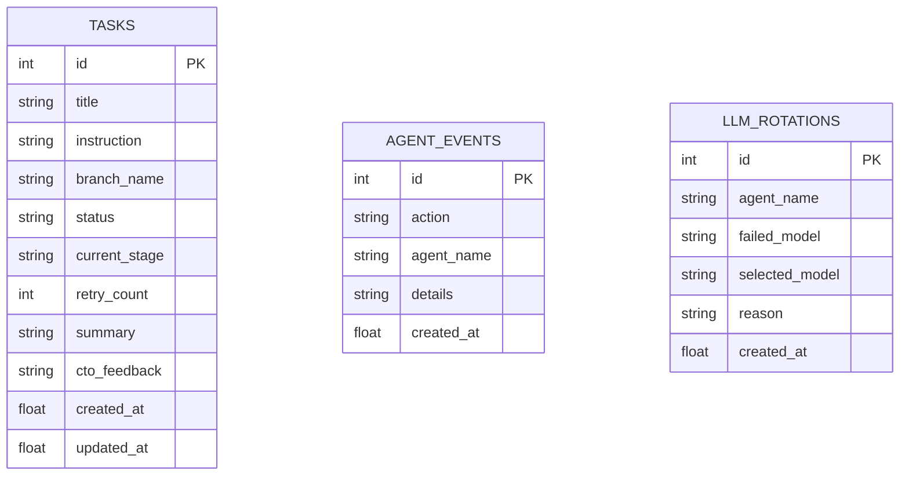

# 3. Skema Database (Entity-Relationship Diagram)

> Halaman ini mendokumentasikan skema database internal perusahaan (`data/company_state.db`) serta tabel database produk yang dirancang oleh **`@architect`**.

## Skema Database State Perusahaan (`company_state.db`)

