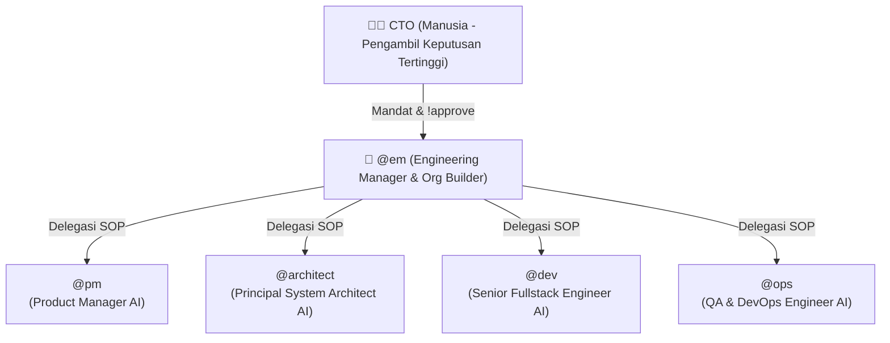

# Struktur Organisasi Karyawan AI (Live Org-Chart)

> Halaman ini di-*generate* secara otomatis oleh **Dynamic Agent Factory (`orchestrator/agent_factory.py`)** setiap kali `@em` (Engineering Manager) atau **CTO** menambah agen baru (`hire_agent`) atau mengubah fokus agen (`specialize_agent`).

## 1. Bagan Hirarki Tim Aktif

## 2. Daftar Roster Karyawan AI & Izin Tool

| Agent ID | Role & Deskripsi | Status | Tools Diizinkan | File SOP |
| :--- | :--- | :--- | :--- | :--- |
| `@em` | Engineering Manager & Org Builder AI - Supervisor utama yang menerima instruksi CTO, merekrut/memodifikasi agent spesialis via Agent Factory, dan mengatur kerja PM, Architect, Dev, serta Ops | **Inti (Core)** | `write`, `edit`, `bash`, `task` | `.opencode/agent/em.md` |
| `@pm` | Product Manager AI - Mentransformasikan ide CTO/EM menjadi PRD terstruktur dan terukur dengan prinsip efisiensi sumber daya | **Inti (Core)** | `write`, `edit` | `.opencode/agent/pm.md` |
| `@architect` | Principal System Architect AI - Mengelola desain sistem hemat sumber daya, ADR, diagram Mermaid C4/ERD/Sequence di docs/architecture/, dan menjawab pertanyaan teknis CTO | **Inti (Core)** | `write`, `edit`, `bash` | `.opencode/agent/architect.md` |
| `@dev` | Senior Fullstack Engineer AI - Menulis kode bersih di feature branch, membuat unit test, dan mematuhi batas alokasi host | **Inti (Core)** | `write`, `edit`, `bash` | `.opencode/agent/dev.md` |
| `@ops` | QA & DevOps Engineer AI - Menjalankan test suite, memantau telemetri sumber daya sistem, dan menyiapkan PR untuk Approval CTO | **Inti (Core)** | `bash` | `.opencode/agent/ops.md` |

## 3. Riwayat Evolusi Organisasi (HR & Specialization Log)

- **`HIRE_AGENT`** pada `@security-auditor`: `{"title": "Application Security Auditor", "description": "Mengaudit celah keamanan OWASP, SQLi, dan XSS", "tools": ["bash"]}`
