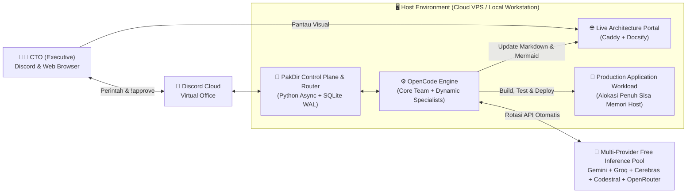

# 1. System Context & Container Diagram

> Dikelola secara otomatis oleh **`@architect`**. Setiap penambahan *service*, database, atau integrasi eksternal wajib tercermin pada diagram di bawah ini.

## Diagram Konteks & Container (C4 Level 1 & 2)

